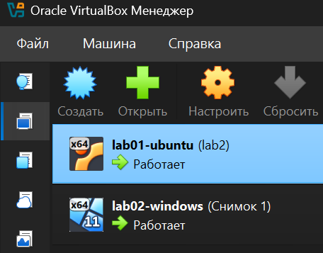
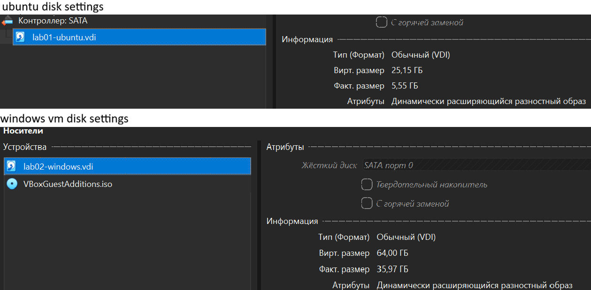
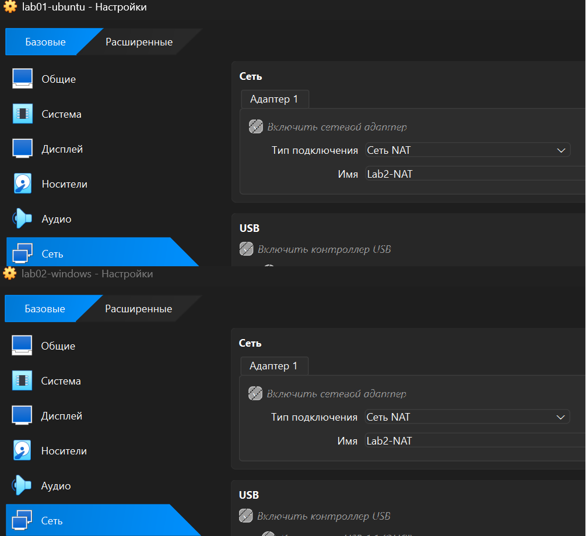
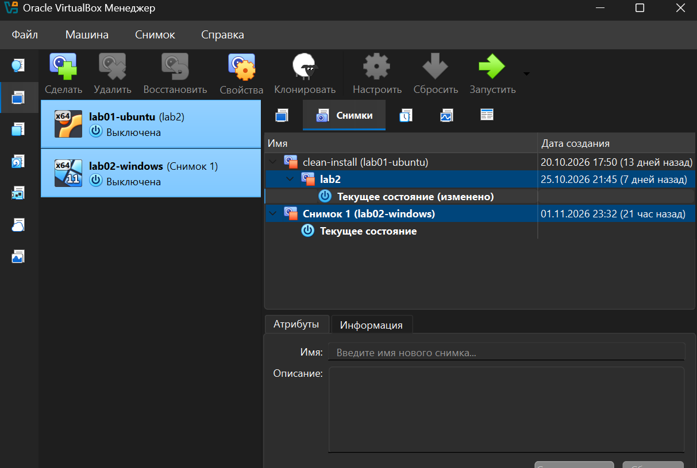

# BUILD.md — Rebuild the Linux and Windows test VMs

This guide is for a person who has a Windows 11 computer and internet access but has never used a hypervisor. Follow the steps in order. The example resource values match the Lab 1 and Lab 2 build described in `README.md`.

> **Important:** A virtual machine is safer than installing test software directly on the host, but it is not a perfect security boundary. Do not enable shared folders, shared clipboard, drag-and-drop, or USB passthrough unless the developer needs them. Do not use this setup to test malware or other dangerous software. Snapshots can roll back the guest VM, but they do not undo actions on the host or other network systems.

## Target configuration

| Setting | Ubuntu Server guest | Windows 11 guest |
|---|---:|---:|
| RAM | 4,090 MB | 4,090 MB |
| Virtual CPUs | 2 | 4 |
| Virtual disk | 25 GB | 64 GB |
| Disk type | Dynamically allocated | Dynamically allocated |
| Network | Same NAT Network | Same NAT Network |
| Firmware/security | Use the installer/VirtualBox default unless your environment requires UEFI | UEFI, Secure Boot enabled, TPM 2.0 |

The two guests use about 8 GB of the 32 GB host RAM while running. The combined virtual disk capacity is 89 GB. Dynamic disks grow as data is written; snapshots can use additional host storage.

## Step 1. Check the host computer

On the **host computer (the physical Windows 11 laptop)**, open **Task Manager → Performance** and check Memory and CPU. Open **File Explorer → This PC** and check free space on the drive where you will store the VMs. For the reference build, the host had 32 GB RAM, 16 CPU processors/threads, about 937 GB free on C: and about 1,024 GB free on D:.

Choose a drive with enough free space and permission to store large files. In the reference build, D: is the sensible place for the VM folder because it has about 1 TB free and keeps VM files separate from the Windows system drive.


> **Check:** You should know the host's total RAM, CPU count, and free disk space before assigning resources. Never give the VMs all the host's RAM or CPU capacity.

## Step 2. Download and install VirtualBox

On the **host computer**, open the official [Oracle VirtualBox downloads page](https://www.oracle.com/virtualization/technologies/vm/downloads/virtualbox-downloads.html). Download the **Windows hosts** base installer and run it. Accept the standard networking components when the installer asks; the virtual network driver is needed for VM networking. Approve the Windows security prompt if it appears, and restart the host if the installer requests it.

The VirtualBox base package is offered under GPLv3. Do not download or install the Extension Pack for this exercise: basic virtual machines, snapshots, and NAT Network do not require it. The Extension Pack has separate licence terms.

> **Check:** Open Oracle VM VirtualBox Manager from the Start menu. The application window should open without an installation error.

## Step 3. Download the two operating-system images

On the **host computer**, download the Ubuntu Server ISO from the official [Ubuntu Server download page](https://ubuntu.com/download/server). For this build, use **Ubuntu Server 26.04.1 LTS, 64-bit (AMD64)**. Choose Server rather than Desktop because this reference guest is a command-line server environment with a smaller resource footprint. If the developer needs a Linux graphical desktop, stop and ask whether Ubuntu Desktop is more suitable.

Next, open Microsoft's [Windows 11 Enterprise Evaluation Center](https://www.microsoft.com/en-us/evalcenter/evaluate-windows-11-enterprise) and register/download the x64 ISO. Select the Enterprise Evaluation image. Microsoft describes this as a 90-day evaluation. It is for evaluation, not a permanent production licence; arrange an appropriate Windows licence for ongoing business use.

Save both ISO files in a folder that will not be moved while the VMs are using them, for example `D:\ISO`. Do not delete the ISOs until both installations are complete.


> **Check:** You should have one Ubuntu Server `.iso` file and one Windows 11 Enterprise Evaluation `.iso` file. Keep the official download pages in your build notes.

## Step 4. Create one shared NAT Network

On the **host computer**, open VirtualBox Manager. Open **Tools → Network** or **File → Tools → Network Manager** (the wording can vary slightly by VirtualBox version). Select the **NAT Networks** tab and create a network. Give it a clear name such as `dev-test-net`, enable it, and enable DHCP if that option is shown.

Use a NAT Network rather than ordinary NAT. Ordinary NAT gives a guest internet access, but it does not provide direct guest-to-guest communication by default. NAT Network behaves more like a small private router: guests attached to the same NAT Network can communicate with each other and reach external networks.


> **Check:** The NAT Network should appear in the list and be enabled. Record its exact name; you must select the same name for both guests.

## Step 5. Create the Ubuntu Server VM

On the **host computer**, in VirtualBox Manager, click **New**. Give the VM a clear name such as `lab01-ubuntu`. Select the Ubuntu Server ISO you downloaded and choose Linux / Ubuntu (64-bit) if VirtualBox does not detect it automatically. Choose the manual installation option (skip unattended installation) so that you can follow the Ubuntu installer yourself.

Set **Base Memory** to **4,090 MB**, **Processors** to **2**, and create a new virtual hard disk of **25 GB**. Select **dynamically allocated** storage. Set the VM folder to the drive chosen in Step 1. These values match the reference build: they give the server enough resources for basic development tests while leaving most host resources available.





> **Check:** The VM appears in the VirtualBox machine list. Before starting it, open **Settings → System** and verify 4,090 MB RAM and 2 CPUs. Under **Settings → Storage**, verify the 25 GB virtual disk is dynamically allocated.

## Step 6. Install Ubuntu Server

On the **host computer**, select `lab01-ubuntu` in VirtualBox Manager and click **Start**. The Ubuntu installer opens inside the **Ubuntu VM window**. Choose the language and keyboard layout. Use the normal network configuration with DHCP unless your office network administrator has supplied different settings. Leave the proxy blank if your network does not require one. Use the guided storage option for the VM's virtual disk only; do not select or format a physical host disk.

Create the first user account and finish the installer. When installation completes, reboot the guest and detach/eject the installer ISO when VirtualBox asks, so the VM boots from its virtual hard disk next time. Sign in and install updates:

```bash
sudo apt update
sudo apt upgrade -y
```

Inside the **Ubuntu VM**, collect the system information:

```bash
uname -a
lsb_release -a
```

Check the current IP address:

```bash
ip -4 addr
```

> **Check:** Ubuntu boots from its virtual disk, you can sign in, and `uname -a` displays Linux kernel and architecture information. `lsb_release -a` should identify the installed Ubuntu release.

## Step 7. Create the Windows 11 VM

On the **host computer**, return to VirtualBox Manager and click **New**. Name the VM `lab02-windows`, select the Windows 11 Enterprise Evaluation ISO, and choose Windows 11 (64-bit). Use the manual installation option so you can see and control the Windows setup.

Set **Base Memory** to **4,090 MB**, **Processors** to **4**, and create a **64 GB dynamically allocated** virtual disk. This is the reference Lab 2 configuration. The disk size matches the Windows 11 minimum storage baseline, but it can be tight if the developer installs several large IDEs, SDKs, or containers.


> **Check:** The Windows VM appears in the machine list with 4,090 MB RAM, 4 virtual CPUs, and a 64 GB dynamic disk.

## Step 8. Enable Windows 11 firmware and security settings

On the **host computer**, make sure `lab02-windows` is fully powered off, not merely saved. Select it and open **Settings → System → Motherboard**. Enable **UEFI** and **Secure Boot**. In the TPM setting, select **TPM 2.0**. These settings are required to meet the important Windows 11 firmware and security requirements. Do not apply these Windows-specific settings to Ubuntu unless you have a separate reason to do so.


> **Check:** Reopen the settings and confirm UEFI and Secure Boot are enabled and TPM Version is 2.0 before starting the Windows installer.

## Step 9. Install Windows 11 Enterprise Evaluation

On the **host computer**, select `lab02-windows` and click **Start**. The installer runs inside the **Windows VM window**. Follow the setup screens. Choose the Windows 11 Enterprise edition if the installer asks you to select an edition. Choose a custom installation and install to the unallocated space on the VM's 64 GB virtual disk. Do not select a physical host drive.

Complete the first-run setup and sign in using the account method allowed by the evaluation image. A product key is not required for Microsoft's evaluation download, but the evaluation is time-limited. Install available Windows updates before creating the clean snapshot.


> **Check:** Windows starts from the virtual disk and reaches the desktop. Open Settings → System → About to confirm the guest is Windows 11 Enterprise.

## Step 10. Connect both guests to the same NAT Network

Power off each VM before changing its adapter settings. On the **host computer**, select `lab01-ubuntu` → **Settings → Network → Adapter 1**. Set **Attached to** to **NAT Network**, then select the network name created in Step 4. Repeat the same steps for `lab02-windows` and select exactly the same NAT Network name.



> **Check:** Both VMs must show `NAT Network` and the same network name. Do not use ordinary NAT for one guest and NAT Network for the other if they must communicate directly.

## Step 11. Test guest-to-guest and internet connectivity

Start both VMs. Inside the **Ubuntu VM**, open Terminal and check the current address with `ip -4 addr`. Inside the **Windows VM**, open Command Prompt and check the current address with `ipconfig`. The reference lab observed Ubuntu at `10.0.2.4` and Windows at `10.0.2.5`, but DHCP addresses can differ on another build.

Run these tests using the current addresses shown by the guests.

Inside the **Ubuntu VM**:

```bash
ping -c 4 <WINDOWS_VM_IP>
ping -c 4 ubuntu.com
```

Inside the **Windows VM** (Command Prompt):

```cmd
ping <UBUNTU_VM_IP>
ping ubuntu.com
```

Save the full output from both terminals, including the commands and packet statistics, in `evidence/05-ping-between-guests.txt`. Do not rewrite the output as a summary. If you collect output in separate files first, paste the complete terminal output into this one evidence file without editing the command results.


> **Check:** Both guest-to-guest tests and both internet tests should succeed. The reference build reported 4 packets sent, 4 received, and 0 lost for all four tests.

### If Windows does not answer ping

Do not turn off Windows Firewall. Inside the **Windows VM**, open **Windows Defender Firewall with Advanced Security**. Create an inbound rule that allows **ICMPv4 Echo Request** from the NAT Network/local subnet. Limit the remote addresses to the NAT Network subnet where possible. Keep the firewall enabled. Repeat the ping tests afterwards.

## Step 12. Create clean baseline snapshots

First update both guests and verify that they boot and connect to the network. Close applications and shut down the guest normally. On the **host computer**, select `lab01-ubuntu` in VirtualBox Manager and open **Snapshots**. Click **Take**, name the snapshot `Clean baseline - Ubuntu Server`, and add a short description with the OS version and date. Repeat for `lab02-windows`, naming it `Clean baseline - Windows 11 Enterprise Evaluation`.

A clean snapshot should be made before the developer starts experimenting. To return a guest to this state later, shut down the VM, open its **Snapshots** tab, select the clean baseline, and click **Restore**. Confirm the restore only when you are ready to discard changes made after that snapshot. Restoring a snapshot reverts the guest's virtual disks and can delete files created inside the VM after the snapshot. It does not undo changes made on the host or other machines, so it is not a backup.



> **Check:** The Snapshots view should show a clearly named clean baseline under each guest. Take the screenshot only after confirming both VMs are visible and the names are readable.

## Step 13. Common problems and safe checks

### VM has no internet

- On the **host computer**, open VirtualBox Network Manager and confirm the NAT Network is enabled.
- Check that the guest adapter is attached to that exact NAT Network.
- Inside Ubuntu, run `ip -4 addr`; inside Windows, run `ipconfig`.
- Check DNS by trying `ping ubuntu.com`. If DNS fails but a known IP works, investigate DNS settings rather than changing the guest's disk or reinstalling the OS.

### Guests cannot ping each other

- Confirm both VMs use the same NAT Network name, not two different NAT Networks.
- Recheck both IP addresses; DHCP may have changed them.
- Check Windows Firewall. Allow the required inbound ICMPv4 Echo Request rule instead of disabling the firewall.

### Windows installer says the computer does not meet requirements

- On the **host computer**, power off the Windows VM.
- Open the Windows VM's **Settings → System → Motherboard**.
- Confirm UEFI, Secure Boot, and TPM 2.0 are enabled.
- Confirm the VM has at least the reference 4,090 MB RAM and a 64 GB virtual disk.
- Start the Windows VM again and retry the installer.

### Host becomes slow

- Shut down a guest that is not needed.
- Do not increase guest RAM or CPU without checking Task Manager on the **host computer** first.
- Keep enough free space for dynamic disk growth and snapshots.

## Official download and reference links

- [Oracle VirtualBox downloads](https://www.oracle.com/virtualization/technologies/vm/downloads/virtualbox-downloads.html)
- [Oracle VirtualBox 7.2 User Guide](https://docs.oracle.com/en/virtualization/virtualbox/7.2/user/index.html)
- [Ubuntu Server downloads](https://ubuntu.com/download/server)
- [Microsoft Windows 11 Enterprise Evaluation Center](https://www.microsoft.com/en-us/evalcenter/evaluate-windows-11-enterprise)
- [Microsoft Windows 11 system requirements](https://support.microsoft.com/en-us/windows/experience/compatibility/windows-11-system-requirements)
